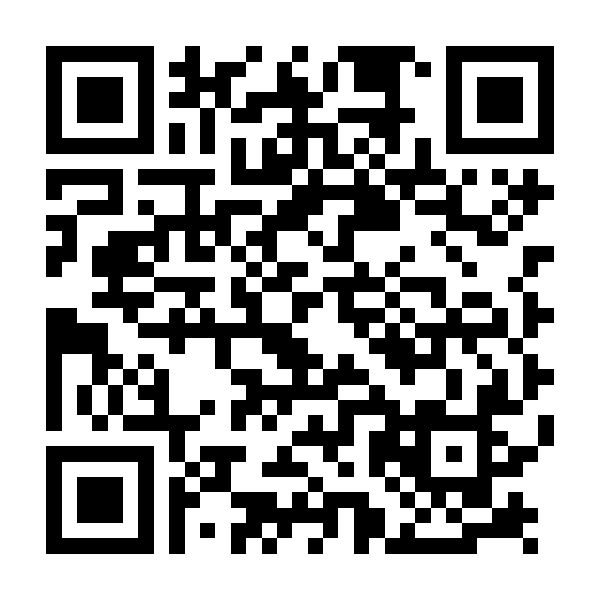

# Reproducibility, Transparency, and Data Ethics

:::{.title-slide}
*How and when to share data, and when not to*
:::

:::: {.columns}

::: {.column width="10%"}

:::

::: {.column width="50%"}

{width="200"}

Lars Vilhuber
 
Cornell University

:::

::: {.column width="30%"}

:::

::: {.column width="10%"}

:::

::::
